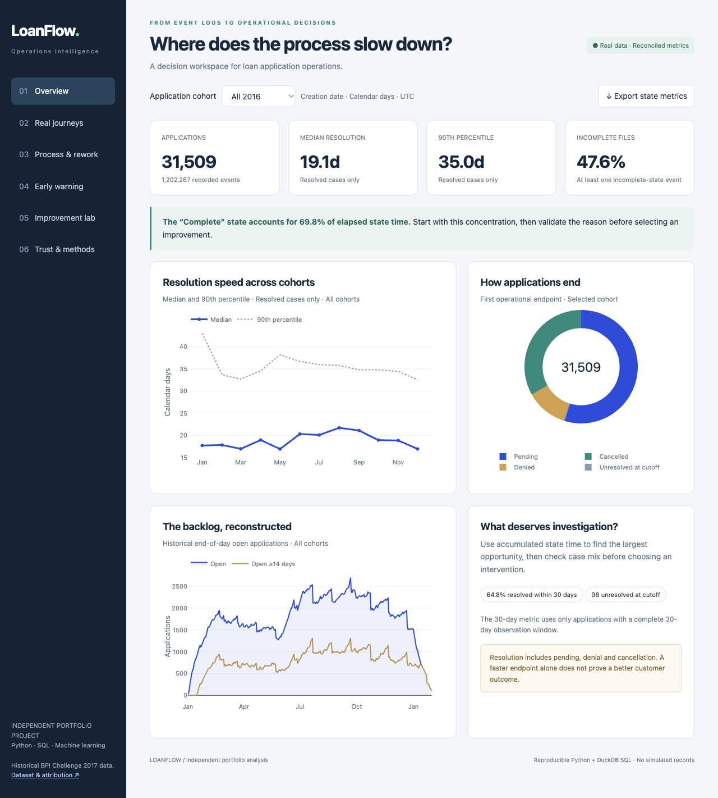
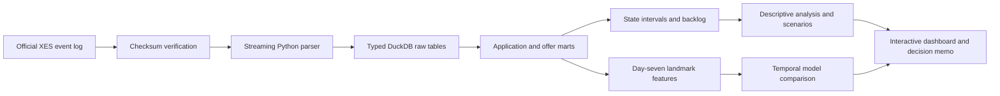

# LoanFlow — Loan Operations Intelligence

[Interactive dashboard](https://maxliston.github.io/loanflow-operations-analytics/) · [Source code](https://github.com/MaxListon/loanflow-operations-analytics) · [Executive memo](reports/EXECUTIVE_MEMO.md)

**Where should an operations team intervene to shorten loan application journeys—and what evidence would justify doing so?**

An end-to-end portfolio project built with **Python, DuckDB SQL, scikit-learn, Plotly and Streamlit**, using the real BPI Challenge 2017 loan application event log. The project turns 1.2 million lifecycle events into reconciled business metrics, a decision dashboard, an early-warning model and an experiment proposal.

## Start here

- **Open `dashboard/index.html` in a browser.** It is a self-contained, interactive demo; no installation, account or internet connection is required. It contains cohort filters, six analytical views, an improvement slider and a CSV export.
- Read **[the executive decision memo](reports/EXECUTIVE_MEMO.md)** for findings and a proposed pilot.
- For implementation, start with **[the SQL marts](sql/02_marts.sql)** and **[the prediction design](sql/03_landmark.sql)**.
- See **[the methodology](docs/METHODOLOGY.md)** and **[the model card](docs/MODEL_CARD.md)** before interpreting the results.



## What the analysis found

| Evidence | Measured result | Decision implication |
|---|---:|---|
| Dataset scale | 31,509 applications; 1,202,267 events; 42,995 offers | Multiple offers and lifecycle events require careful aggregation |
| Time to first operational endpoint | Median 19.1 days; P90 35.0 days among resolved cases | The upper tail deserves attention alongside the typical case |
| State-time concentration | A_Complete contains 69.8% of elapsed state time among resolved cases | Investigate this stage before assuming incomplete documentation is the main bottleneck |
| Rework and outcome mix | Incomplete cases have shorter pooled medians, but longer medians within the pending-endpoint group | Overall averages can tell a different story from like-outcome comparisons |
| Day-seven early-warning model | Test ROC AUC 0.696; top-20% precision 55.1% vs. 38.2% prevalence | Risk can prioritize investigation, but does not estimate intervention benefit |
| Simple state-only baseline | Test ROC AUC 0.652; Brier 0.207 vs. selected model 0.203 | The additional model benefit is modest; weigh maintenance cost |
| Mechanical 25% A_Complete compression | Resolved-case median changes from 19.1 to 16.5 days | A scenario to investigate, not a proven reduction or realized saving |

**No operational improvement was implemented.** Outcomes are historical, and the scenario preserves observed outcomes. A_Pending is treated as an operational endpoint, not proof of loan disbursement.

## Version 2: deeper evidence, not inflated accuracy

- **Real journeys:** Six deterministically selected source applications, original event ordinals/timestamps, common state sequences and transitions.
- **Competing outcomes:** Censoring-aware pending, cancellation and denial curves, keeping speed separate from desirable outcomes.
- **Point-in-time sensitivity:** A frozen event-history-only challenger excludes trace attributes whose mutability is unknown.
- **Temporal audit:** A further **2,466 November cases** show context-model AUC declining to **0.671**. The history-only model does not consistently improve probability quality over the simple state baseline.
- **Calendar uncertainty:** Creation-week cluster bootstrap and monthly performance/capacity diagnostics.
- **Pilot planning:** Measured baseline from **23,181 eligible cases**, with sample-size calculations for explicitly assumed effects. A hypothetical five-percentage-point effect requires about **1,525 cases per arm** under the stated normal approximation.
- **Source-to-report audit:** Publisher checksum, source SHA-256, cached-extraction hashes and artifact fingerprints. Corrupted cached CSVs trigger a rebuild.
- **Validation:** 86 tests and 24 runtime integrity checks, including all seven Streamlit views.

See [the fixed extension protocol](docs/UPGRADE_PROTOCOL.md), [robustness results](reports/robustness.json) and [real-data evidence](reports/source_provenance.json).

## Hardened replay service

The project includes an authenticated FastAPI service, strict event-history/time validation, bounded requests, aggregate monitoring and immutable JSON model releases with atomic activation and rollback. It uses the state-only baseline deliberately and rejects new cohorts outside the historical release scope. Research models remain available for comparison.

The public dashboard and replay API are separate components. No API credentials are embedded in the demo, and no live banking system is connected.

[Service runbook](docs/PRODUCTION_RUNBOOK.md) · [System architecture](docs/SYSTEM_ARCHITECTURE.md) · [Verification limits](docs/VERIFICATION_LIMITS.md) · [Measured local smoke/concurrency evidence](reports/service_smoke.json)

```bash
python -m pip install -e '.[api,dev]'
python -m loanflow.pipeline
python -m loanflow.release
python scripts/smoke_service.py
```

The API/release/locking modules have **95% measured line coverage** in the local suite. Docker and GitHub CI configuration are provided. The Linux image build and full real-data rebuild passed in GitHub CI; Docker is unavailable locally. this is a hardened historical-replay/pilot scaffold, not a certified live banking production deployment.

## Reproduce the project

Python 3.11+ is declared; the delivered build was tested with Python 3.14 on macOS. Use a fresh virtual environment.

```bash
python3 -m venv .venv
source .venv/bin/activate
python -m pip install -e '.[dev]'
python -m loanflow.pipeline
python -m pytest -q
# Optional cold-source reproduction check (reuses installed Python libraries):
python scripts/verify_reproduction.py
streamlit run dashboard/app.py
```

On Windows, activate with `.venv\Scripts\activate` instead. The pipeline downloads the compressed public dataset (about 30 MB), verifies its published MD5, streams XES into typed tables, runs the SQL, checks integrity, fits models and rebuilds reports and the standalone dashboard. Allow approximately 1 GB of free disk space for source, extracted files and database. Runtime depends on the machine. A source mirror is tried only if the publisher download fails; the same official checksum is required.

`python -m loanflow.pipeline --refresh-extract` forces a fresh parse. Run builds with the Streamlit process stopped so the database can be replaced without concurrent access.

For the exact versions used in this macOS/Python 3.14 build, see `requirements-lock.txt`. The portable dependency ranges are in `pyproject.toml`; use those when exact pins do not support your operating system or Python version.

The executed notebook at `notebooks/01_decision_analysis.ipynb` includes real query outputs. Open it in a notebook-capable editor; install its optional runtime with `python -m pip install -e '.[notebook]'`.

## Architecture



The application mart has one row per application. Offers are aggregated before joining. Application-state time is built from application events only, capped at the first operational endpoint. Raw workflow events remain available for audit; they are not misinterpreted as independent process stages.

## Project structure

```text
loanflow/
  dashboard/            Self-contained demo and live Streamlit workspace
  src/loanflow/         Ingestion, quality, analysis, modeling and reporting
  sql/                  Typed load, reporting marts and landmark features
  notebooks/            Guided SQL/Python analysis
  tests/                Synthetic edge cases and real-data integration tests
  reports/              Findings, metrics, predictions and audit evidence
  docs/                 Definitions, model card, presentation and study roadmap
  data/raw/             Original source and provenance (excluded from Git)
  data/processed/       DuckDB database, extracted CSVs and model (excluded from Git)
```

The downloadable portfolio archive excludes the raw records and processed database. Its demo and reports work immediately; the pipeline reproduces data-dependent features. The working folder delivered alongside it already contains the built database and data.

## Analytical safeguards

- Twenty-four automated integrity checks cover source counts, keys, references, join totals, nonnegative intervals, state-time reconciliation and temporal cutoffs.
- Ninety-eight applications remain unresolved at the cutoff; they are retained and censored in the survival analysis.
- Raw zero requested amounts are preserved; 3,080 are treated as unknown in the mart and model.
- One application has multiple terminal events. The first defines its endpoint; raw events are retained.
- Model fitting and preprocessing use January–May data, July selects the model, and September–October is the final evaluation. Gaps separate label windows from subsequent periods.
- Baselines include constant training prevalence and a smoothed current-state model. Calibration, Brier score, ranking, review capacity and application bootstrap uncertainty are reported.
- Scenario results measure application-days, not employee workdays or financial savings.

## Portfolio materials

[Resume bullets and interview guide](docs/PORTFOLIO_GUIDE.md) · [Eight-week learning and extension roadmap](docs/EIGHT_WEEK_ROADMAP.md) · [Data dictionary](docs/DATA_DICTIONARY.md) · [Technical decisions](docs/DECISIONS.md)

## Source and attribution

van Dongen, Boudewijn (2017). **BPI Challenge 2017**. 4TU.ResearchData. [Dataset DOI](https://doi.org/10.4121/uuid:5f3067df-f10b-45da-b98b-86ae4c7a310b). [Publisher metadata](https://api.figshare.com/v2/articles/12696884). Source checksum: `10b37a2f78e870d78406198403ff13d2`.

The source covers 2016 applications at one Dutch financial institution, with subsequent events into February 2017. Dataset terms are the **4TU General Terms of Use**, linked in `data/raw/source_metadata.json`; those terms apply separately from the software license. This project is not affiliated with the institution or dataset publisher. The historical data does not establish current lending performance or profitability.
