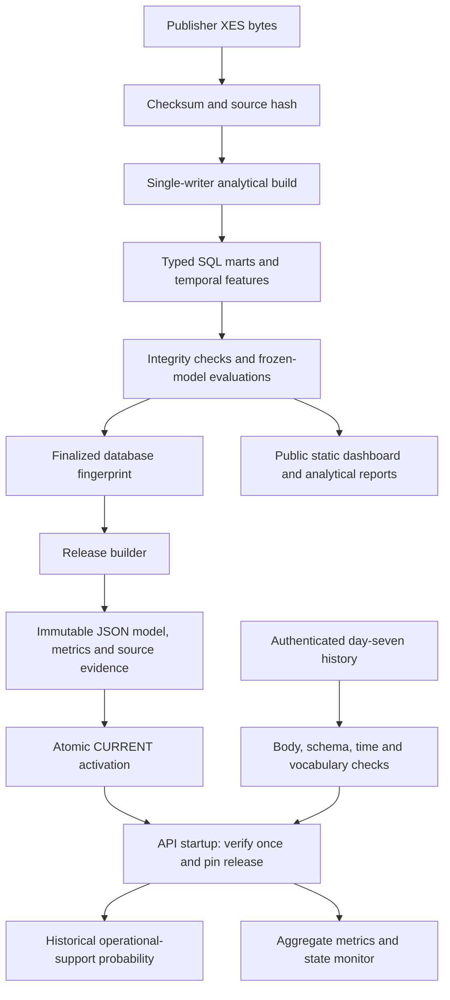

# System architecture and failure boundaries

**Serving isolation:** the API never opens the working warehouse. Rebuilds, model fitting and publication are outside the request path. Only the compact state-model JSON is loaded; joblib files remain research artifacts.

**Release consistency:** a content-derived ID binds files and policy. Activation writes a new complete pointer atomically; running processes do not reload partial files. Rollback is explicit and requires restart. Filesystem permissions protect authenticity; hashes detect accidental changes but are not signatures.

**Scoring consistency:** requests provide source event histories, not caller-calculated model features. The service derives the last application state using timestamp and source ordinal, matching the SQL tie-break. Tests replay an actual source history and compare its probability with the SQL-derived training baseline.

**Temporal scope:** the served model uses training-only state rates and explicit smoothing. The operational horizon is day 30 from creation, scored exactly at day seven. Historical cohorts are permitted; a new live population is rejected by the release policy.

**Deployment split:** the public dashboard is a static retrospective case study. It contains neither an API credential nor a live connection to a bank. The authenticated replay API is a separate deployable component. Publishing the dashboard does not deploy the API.

**Recovery:** a failed analytical build leaves the previous service release intact. A failed release verification leaves CURRENT unchanged. A corrupt CURRENT or missing release causes startup failure rather than default predictions. In-memory monitoring and limits reset on restart; infrastructure controls must handle durability and multiple instances.
